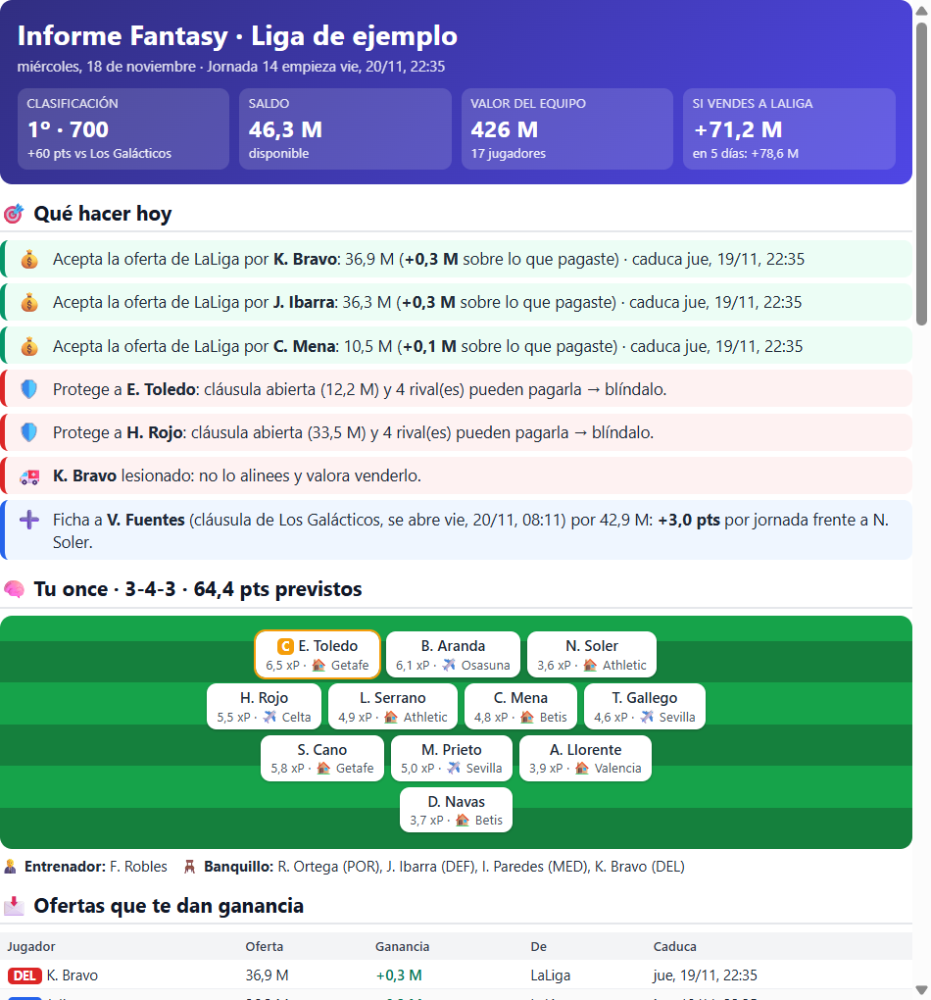

# LaLiga Fantasy · Analítica y automatización

[](https://github.com/Externoak/LaLigaApp)


[](https://github.com/alfreedx/laligaapp-fork/actions/workflows/ci.yml)

Fork personal de **[LaLigaApp](https://github.com/Externoak/LaLigaApp)** (app de escritorio no oficial de LaLiga Fantasy) que añade **análisis de rentabilidad**, **previsión de puntos**, **inteligencia sobre los rivales** y un **informe diario automático** pensado para tomar mejores decisiones de mercado y alineación.

> ⚠️ **Proyecto no oficial.** No está afiliado con LaLiga, LaLiga Fantasy ni futbolfantasy.com. La API de LaLiga Fantasy no es pública: úsala con moderación y bajo tu responsabilidad.

<p align="center">
  
  <br><sub>Informe diario en PDF (datos ficticios)</sub>
</p>

---

## Índice

- [Funcionalidades](#funcionalidades)
- [Instalación](#instalación)
- [Uso](#uso)
- [Automatización diaria](#automatización-diaria)
- [Desarrollo](#desarrollo)
- [Estructura del proyecto](#estructura-del-proyecto)
- [Seguridad y privacidad](#seguridad-y-privacidad)
- [Documentación](#documentación)
- [Créditos y licencia](#créditos-y-licencia)

## Funcionalidades

Además de todo lo que ya ofrece LaLigaApp (mercado, plantillas, cláusulas, actividad, onces probables… ver [README original](docs/upstream/README.md)), este fork añade:

| Área | Qué aporta |
|---|---|
| 📈 **Rentabilidad** | Precio de compra de **todos** los jugadores de la liga reconstruido desde la actividad; ganancia latente y efectiva; mejor oferta posible de LaLiga (+10 %); proyección del valor a N días con el histórico de futbolfantasy; exportación a CSV. Pestañas: mi equipo, once, mercado, rivales, dinero de rivales y mis ventas. |
| 🧠 **Previsión y alineación** | Puntos esperados (xP) por jugador según media, forma, casa/fuera y probabilidad de jugar. Once óptimo con formaciones estándar y premium, **capitán, entrenador y banquillo**; botón *Cargar recomendada* en Mi Alineación con verificación tras guardar. |
| 🕵️ **Rivales** | Dinero estimado de cada manager, sobrepuja habitual en las pujas, actividad reciente y subidas de cláusula detectadas entre capturas diarias. |
| 🛡️ **Protección** | Jugadores propios expuestos a cláusula, qué rivales pueden pagarla y si conviene blindar o subir la cláusula. |
| 📄 **Informe diario** | Dos ediciones: **18:50** *Antes del cierre* y **19:10** *Mercado nuevo*. *Qué hacer hoy*, once recomendado, ofertas con ganancia, oportunidades económicas y deportivas (mercado + cláusulas que se abren en 48 h), plantilla y rivales. Se genera en **PDF** (móvil y PC), **Markdown** y **JSON** en la carpeta que elijas (p. ej. Google Drive). |
| 📱 **Telegram** | Cada informe llega al móvil: resumen con *Qué hacer* y el PDF adjunto; también avisos de cláusulas y errores. |
| 🔔 **Avisos** | Notificación (Windows y Telegram) cuando se abre la cláusula de un jugador rival. |
| 🤖 **Auto-mercado** *(opcional)* | Vuelve a poner a la venta tus jugadores a valor de mercado para recibir la oferta diaria de LaLiga. Desactivado y en modo simulación por defecto; **nunca acepta ofertas ni puja**. |
| 📏 **Precisión** | Guarda la previsión antes de cada jornada y la compara con los puntos reales. |

## Instalación

Requisitos: **Windows 10/11**, **Node.js 18+** (probado con Node 26) y **git**.

```powershell
git clone https://github.com/alfreedx/laligaapp-fork.git
cd laligaapp-fork
npm install
```

> Con npm 11+ los scripts de instalación de dependencias requieren aprobación. Electron necesita descargar su binario: `npm install-scripts approve electron` (ya incluido en `package.json` → `allowScripts`).

### Ejecutable de escritorio

```powershell
npm run build:electron                              # genera dist/LaLiga-Fantasy-App/win-unpacked
powershell -ExecutionPolicy Bypass -File scripts/install-local.ps1   # copia a %LOCALAPPDATA%\Programs\LaLigaFantasyFork
```

Abre `LaLiga Fantasy App.exe` desde esa carpeta e inicia sesión con tu cuenta de LaLiga Fantasy.

## Uso

| Sección | Para qué |
|---|---|
| **Rentabilidad** | Tablas ordenables con las métricas económicas y deportivas; elige el ritmo de proyección (último día / media 3 / media 7 días) y el horizonte. |
| **Mi Alineación** | *Cargar recomendada* rellena formación, titulares, capitán, entrenador y banquillo; revisa y pulsa *Guardar*. |
| **Ajustes y automatización** | Carpeta del informe, hora, *Generar informe ahora*, avisos de cláusulas y auto-mercado (con lista de exclusión). |

Glosario rápido: **xP** = puntos esperados la próxima jornada · **LaLiga** = mejor oferta posible de LaLiga (valor +10 %) · **sobrepuja** = cuánto se paga por encima del valor para ganar una puja.

## Automatización diaria

El trabajo diario se ejecuta en cada hora programada (por defecto **18:50**, antes del reseteo de las 19:00, y **19:10**, con el mercado nuevo):

1. Descarga datos frescos (plantillas, mercado, actividad completa, ofertas, futbolfantasy).
2. Guarda una captura local del día (histórico propio; no se sube a ningún sitio).
3. Ejecuta el auto-mercado si está activado.
4. Escribe `informe-fantasy.pdf`, `informe-fantasy.md` y `plantilla.json` en la carpeta configurada (sobrescribe los del día anterior).
5. Muestra una notificación y, si está configurado, envía el resumen y el PDF por **Telegram**.

Si a esa hora la app no estaba abierta, el trabajo se ejecuta en cuanto la abras. Para que funcione con el portátil en suspensión, registra la tarea programada:

```powershell
powershell -ExecutionPolicy Bypass -File scripts/register-task.ps1   # 18:50 y 19:10, despierta el equipo
```

Detalles en [docs/AUTOMATIZACION.md](docs/AUTOMATIZACION.md).

## Desarrollo

```powershell
npm run electron:dev   # servidor proxy (3005) + React (3006) + Electron
npm run dev            # versión web: http://localhost:3006
npm test               # tests (Jest) en modo watch
npm run test:ci        # tests una vez, como en CI
npm run lint           # ESLint sin avisos permitidos
```

La lógica de análisis está en funciones puras con tests (`src/services/analytics`, `src/services/automation`). Más en [docs/ARQUITECTURA.md](docs/ARQUITECTURA.md) y [CONTRIBUTING.md](CONTRIBUTING.md).

## Estructura del proyecto

```
electron/                 proceso principal: IPC, actualizaciones, automatización (PDF, notificaciones, --daily-run)
server/                   proxy local hacia la API de LaLiga Fantasy y futbolfantasy.com
src/
  components/
    Rentabilidad/         página de análisis
    Automation/           vigilante del trabajo diario y avisos
    Settings/             ajustes de automatización
    Teams/LineupEditor.js editor de alineación (capitán, entrenador, banquillo, recomendada)
  hooks/useLeagueAnalytics.js
  services/
    analytics/            ledger, valoración, previsión, rivales, protección, backtest (puro + tests)
    automation/           cargador de datos, informe (modelo, Markdown, HTML), trabajo diario, auto-mercado, avisos
scripts/                  instalación local y tarea programada
docs/                     documentación, notas de la API y README original
```

## Seguridad y privacidad

- Los **tokens de sesión** nunca se escriben en informes, capturas ni en el repositorio.
- La única **acción de escritura automática** es el auto-mercado (opcional, desactivado por defecto). Guardar la alineación solo ocurre al pulsar *Guardar*.
- Los informes y capturas contienen datos de tu liga: se guardan fuera del repositorio (carpeta de datos de la app y la carpeta de exportación que elijas).
- El PDF se genera en una ventana aislada sin JavaScript ni acceso a red; todo texto de la API se escapa.
- La actualización automática desde el repositorio original está **desactivada** para no sobrescribir este fork.

Ver [SECURITY.md](SECURITY.md).

## Documentación

- [CHANGELOG.md](CHANGELOG.md): historial de cambios del fork.
- [docs/ARQUITECTURA.md](docs/ARQUITECTURA.md): flujo de datos y módulos.
- [docs/AUTOMATIZACION.md](docs/AUTOMATIZACION.md): trabajo diario, tarea programada y Google Drive.
- [docs/API-NOTAS.md](docs/API-NOTAS.md): comportamiento observado de la API (temporada 26/27).
- [docs/upstream/README.md](docs/upstream/README.md): README original de LaLigaApp.

## Créditos y licencia

Este producto incluye **"LaLigaApp" (c) 2025–presente Externoak** — https://github.com/Externoak/LaLigaApp/

Modificaciones (c) 2026 alfreedx, distribuidas bajo la misma licencia **GPL-3.0-or-later con Términos Adicionales — Atribución (GPLv3 §7)**. Ver [LICENSE](LICENSE) y [NOTICE](NOTICE). La lista de cambios respecto al original (GPLv3 §5a) está en [CHANGELOG.md](CHANGELOG.md).

Esta atribución no implica respaldo ni patrocinio por parte de los autores originales. Datos de mercado y onces probables: [futbolfantasy.com](https://www.futbolfantasy.com/).
